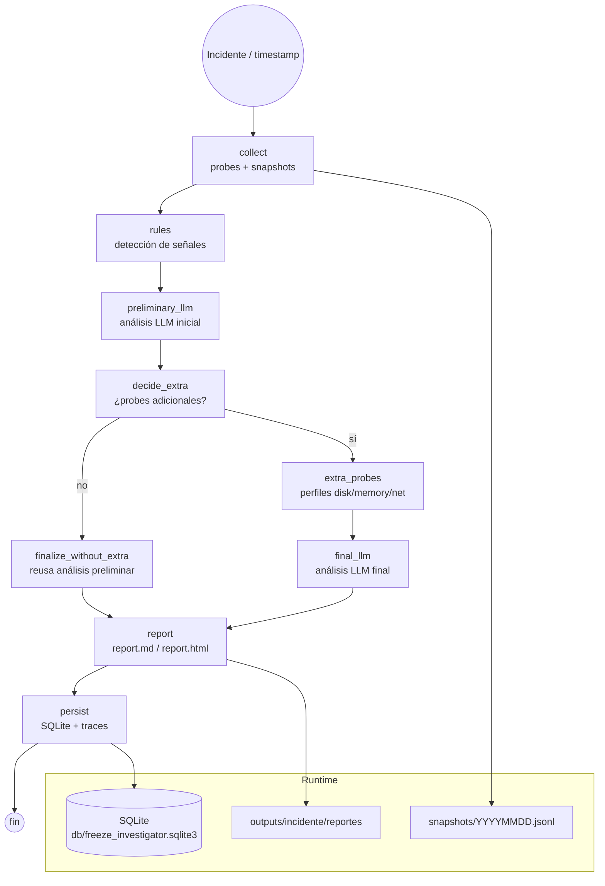

# llm-local-investigator

Workflow de investigación de congelamientos (freezes) de sistemas Linux locales usando LangGraph. Orquesta una investigación de varios pasos: ejecuta comandos de sonda sobre el sistema congelado, analiza la salida con un LLM local (llama.cpp) y presenta los hallazgos vía un dashboard Flask.

[](https://github.com/bi0punk/llm-local-investigator/actions/workflows/ci.yml)
[](https://www.python.org/)
[](LICENSE)

## Contenido

- [Características](#características)
- [Arquitectura](#arquitectura)
- [Stack](#stack)
- [Estructura del repositorio](#estructura-del-repositorio)
- [Instalación](#instalación)
- [Uso](#uso)
- [Configuración](#configuración)
- [Tests / CI](#tests--ci)
- [Datos](#datos)
- [Roadmap](#roadmap)
- [Licencia](#licencia)

## Características

- Workflow LangGraph: captura de artefactos → análisis basado en reglas → análisis LLM (preliminar + final) → reporte.
- Probes de sistema (`dmesg`, `journalctl`, `sensors`, `top`, `ps`, etc.) con detección de perfiles extra (disk, memory, net).
- Análisis con reglas (oom-killer, lockups, etc.) + LLM local (llama.cpp, API OpenAI-compatible).
- Persistencia en SQLite (incidentes, traces, LLM calls, snapshots).
- Dashboard Flask para revisar incidentes históricos.
- Snapshots preventivos cada minuto vía systemd timer.
- Reportes HTML + Markdown por incidente.

## Arquitectura



- **app/graph_flow.py**: define el grafo LangGraph (nodos: `collect → rules → llm_preliminary → llm_final → persist → report`).
- **app/compat_graph.py**: implementación mínima de StateGraph si langgraph no está disponible.
- **app/cli.py**: CLI con subcomandos.
- **app/storage.py**: capa SQLite.
- **app/snapshot.py**: snapshots preventivos continuos.

## Stack

- **Lenguaje**: Python 3.12+.
- **Workflow**: LangGraph (con fallback `compat_graph` si langgraph no está).
- **Web**: Flask (dashboard).
- **LLM**: llama.cpp (servidor OpenAI-compatible local).
- **DB**: SQLite.
- **Validación**: Pydantic.
- **Calidad**: ruff (lint), pytest.

## Estructura del repositorio

```
llm-local-investigator/
├── app/
│   ├── __init__.py
│   ├── cli.py
│   ├── compat_graph.py
│   ├── config.py
│   ├── dashboard.py
│   ├── graph_flow.py
│   ├── llm_client.py
│   ├── models.py
│   ├── probes.py
│   ├── reporting.py
│   ├── rules.py
│   ├── shell.py
│   ├── snapshot.py
│   ├── state.py
│   ├── storage.py
│   ├── trace.py
│   └── utils.py
├── db/                          # SQLite runtime (gitignored)
├── outputs/                     # Reportes por incidente (gitignored)
├── snapshots/                   # Snapshots preventivos (gitignored)
├── scripts/
│   ├── install_ubuntu.sh
│   ├── investigate_example.sh
│   └── start_llama_server_example.sh
├── systemd/
│   ├── freeze-dashboard.service
│   ├── freeze-snapshot.service
│   └── freeze-snapshot.timer
├── tests/test_smoke.py
├── run.py
├── Makefile
├── requirements.txt
├── pyproject.toml
└── LICENSE
```

## Instalación

```bash
uv venv -p 3.12 .venv
uv pip install -e ".[dev]"
# o con pip:
python3.12 -m venv .venv
source .venv/bin/activate
pip install -e ".[dev]"
```

Servicios systemd (snapshots cada minuto + dashboard):

```bash
sudo ./scripts/install_ubuntu.sh
sudo systemctl enable --now freeze-snapshot.timer freeze-dashboard.service
```

Requisitos: Linux nativo (usa `dmesg`, `journalctl`, `sensors`, `ps`, `top`), Python 3.12+, llama.cpp server (opcional si `--skip-llm` o `FI_ALLOW_OFFLINE=1`).

## Uso

CLI (`run.py` o `python -m app.cli`):

```bash
# Investigar un incidente alrededor de un timestamp:
python run.py investigate --incident "2026-02-28 07:00:00"

# Snapshot preventivo único:
python run.py snapshot-once

# Loop continuo de snapshots (o usa el systemd timer):
python run.py snapshot-loop

# Healthcheck del servidor LLM local:
python run.py healthcheck

# Dashboard web:
python run.py serve-dashboard

# Reindexar outputs/ y snapshots/ en SQLite:
python run.py reindex
```

Atajos en el `Makefile`: `make investigate`, `make snapshot`, `make dashboard`, `make healthcheck`.

## Configuración

Variables de entorno (ver `app/config.py`, prefijo `FI_`):

| Variable                  | Default                              | Descripción                                    |
|---------------------------|--------------------------------------|------------------------------------------------|
| `FI_LLM_BASE_URL`         | `http://127.0.0.1:8080`              | URL del servidor llama.cpp                     |
| `FI_LLM_MODEL`            | `local-model`                        | Nombre del modelo                              |
| `FI_LLM_API_KEY`          | `not-needed`                         | API key del servidor LLM                       |
| `FI_LLM_TIMEOUT`          | `180`                                | Timeout de las llamadas LLM                    |
| `FI_LLM_TEMPERATURE`      | `0.0`                                | Temperatura del LLM                            |
| `FI_LLM_MAX_TOKENS`       | `2200`                               | Máximo de tokens por llamada                   |
| `FI_ALLOW_OFFLINE`        | (vacío)                              | Si `1`, permite correr sin LLM (modo fallback) |
| `FI_OUTPUT_DIR`           | `./outputs`                          | Directorio de reportes                         |
| `FI_SNAPSHOT_DIR`         | `./snapshots`                        | Directorio de snapshots                        |
| `FI_DATABASE_PATH`        | `./db/freeze_investigator.sqlite3`   | Ruta de la base SQLite                         |
| `FI_DASHBOARD_HOST`       | `127.0.0.1`                          | Host del dashboard                             |
| `FI_DASHBOARD_PORT`       | `8787`                               | Puerto del dashboard                           |

## Tests / CI

```bash
pytest -q
```

Smoke tests (`tests/test_smoke.py`): imports de módulos de `app`, subcomandos del CLI, higiene del repo (sin DB/outputs/snapshots commiteados), deps listadas. No requieren llama.cpp real.

CI — GitHub Actions (`.github/workflows/ci.yml`) sobre Python 3.12, disparado en push/PR a `main`/`master`:

- **lint** — `ruff check .`.
- **test** — `pytest -q`.

## Datos

Directorios runtime (todos gitignored, se regeneran):

- `db/freeze_investigator.sqlite3` — almacenamiento principal.
- `outputs/incident_<timestamp>/` — reportes (`.md`/`.html`), traces, LLM calls, artefactos por incidente.
- `snapshots/YYYYMMDD.jsonl` — snapshots preventivos (uno por minuto).

## Roadmap

- [x] Workflow de investigación con reglas + LLM preliminar/final.
- [x] Persistencia en SQLite y reportes HTML/Markdown.
- [x] Snapshots preventivos con systemd timer.
- [ ] Más probes (perf, eBPF).
- [ ] Correlación multi-incidente.
- [ ] Alertas proactivas.

Limitaciones a considerar: requiere comandos Linux y permisos (`dmesg`/`journalctl` pueden necesitar `sudo` o el grupo `systemd-journal`); sin tests del workflow end-to-end (necesita LLM real + sistema con incidentes).

## Licencia

MIT — ver [LICENSE](LICENSE).